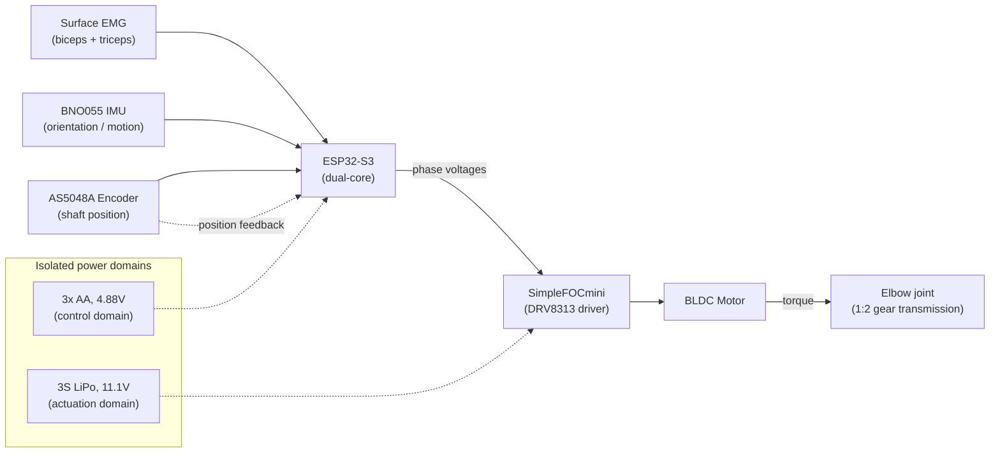
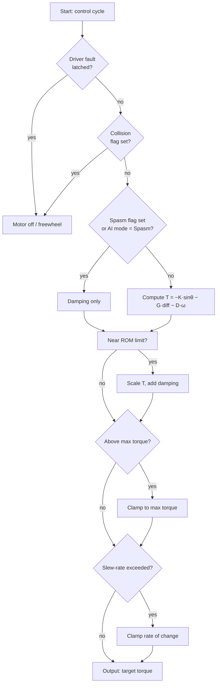
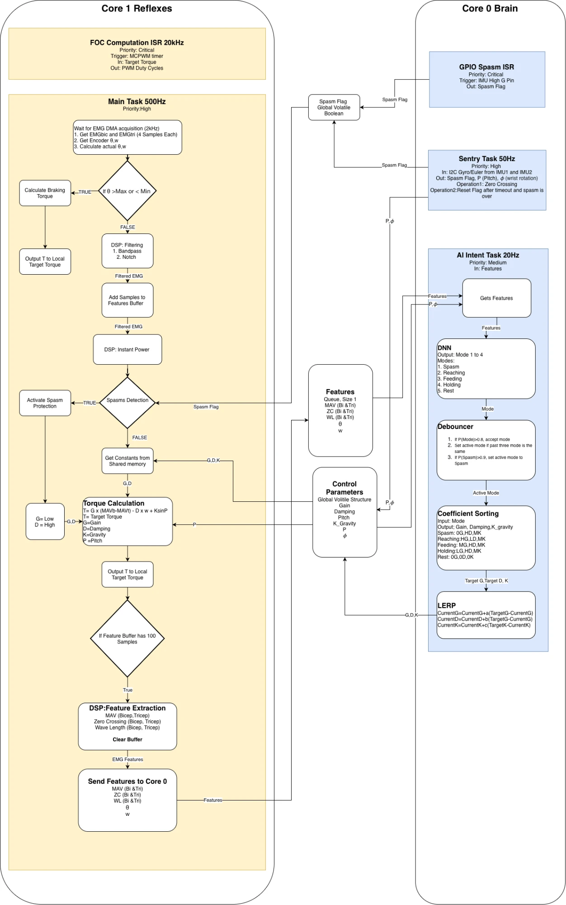
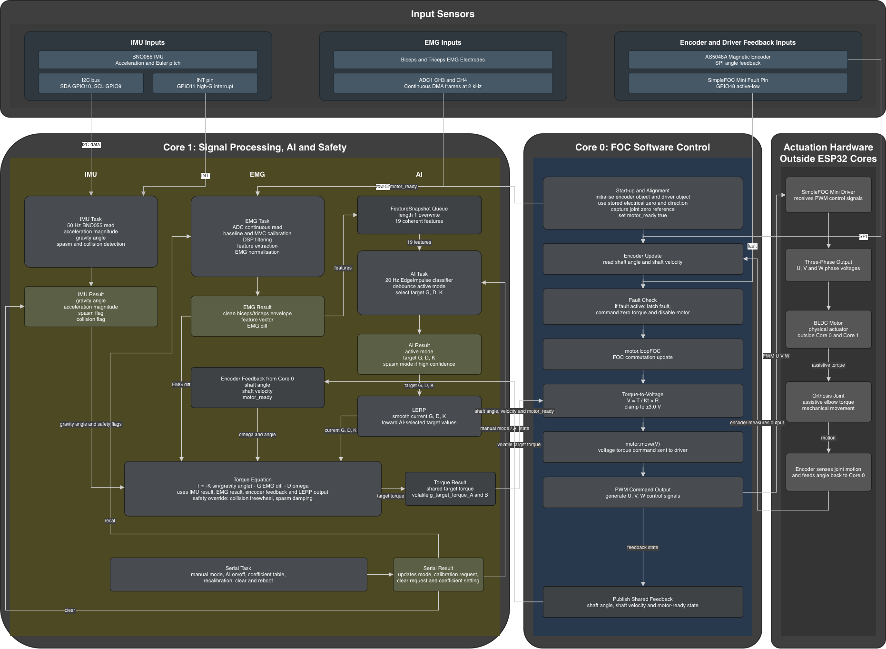

# ExoReach

A wearable, EMG-controlled upper-limb orthosis that provides powered elbow
flexion/extension assistance for paediatric physiotherapy (cerebral palsy
rehabilitation, ages 6–12). Built as a Year 2 group project in the MEng
Biomedical Engineering programme at Imperial College London (DAPP2, June 2026).

<p align="center">
  
  &nbsp;&nbsp;
  
</p>

**My role: Technical Project Manager (team of 8) and Electrical Team Lead /
systems architecture designer.** This team-agreed role made me the
communication link between the mechanical and electrical teams, drawing on
experience in both: I worked with the mechanical team lead (who assigned the
mechanical roles, while I assigned the electrical ones), joined mechanical
team meetings to follow their progress and brief them on ours, and made sure
each side understood changes the other made and how they affected it. In
practice that meant handing over the electrical team's motor choice so the
housing and connections could be designed around it, explaining the wiring of
each component so the housing could be designed, and flagging that moving from
a small purpose-built analogue front end to a larger repurposed ECG
development board changed the space the electronics needed. In the other
direction, the mechanical team set the gear ratio, which I took into account
when specifying the firmware's range-of-motion limit, and we agreed that each
side would implement its own limit (mechanical hard-stops and a firmware
soft-brake; the firmware limit values were not tuned by demo day). I also explained the mechanical design at the preliminary design
review (a feasibility check by the lab technicians) when the mechanical team
could not attend. Within the electrical team I broke the firmware into modules that could be
built independently without breaking each other: for each teammate's module
(for example the IMU driver and the classifier) I specified its inputs and
outputs and treated it as a black box behind that interface. As electrical
lead I designed the dual-core firmware architecture, the EMG signal-conditioning and torque control
pipeline, and the layered safety hierarchy; defined the inputs and outputs of
the on-device classifier and integrated it; led the electrical system
integration; and debugged the demo-day firmware. The IMU driver was written by
a teammate and integrated by me — see [Credits](#credits) below for the full
breakdown.

**AI assistance:** the firmware was developed with AI coding assistance. I made
the architecture, design and debugging decisions and verified the results on
the hardware.

This repo covers the **electrical and firmware side** of the project. Full
mechanical design, requirements, testing, and risk management are documented
in the group's final report, which is not included here.

> **Status of this repository.** It was assembled in October 2026, after the
> project ended (October 2025 – June 2026), from the demo-day firmware and
> development files. It is a documentation snapshot, not a buildable project:
> see [Dependencies and build](#dependencies-and-build).

## Overview

Voluntary muscle activity (biceps/triceps EMG) is combined with IMU
orientation and encoder position/velocity feedback to estimate user intent
and joint state. A microcontroller uses this to compute an assistive torque,
delivered through a BLDC motor and a 1:2 gear transmission, while a layered
safety system watches for driver faults, collisions, and muscle spasms.

**Result (from testing on two subjects):** 145° of elbow flexion, clean and
repeatable EMG spikes correlating with contraction, detection of simulated
spasms and collisions with automatic torque cutoff (tuned conservatively, so
false positives occurred), 683 g total mass (target <500 g, not met), and a
prototype build cost of £230. See [Results](#results).

## System architecture



No single sensor is sufficient on its own: EMG responds quickly but carries
no state information; the encoder measures position accurately but can't
distinguish voluntary from involuntary motion; the IMU detects abnormal
acceleration but has no notion of intent. Combining all three gives both
responsiveness and safety.

### Dual-core task partitioning

The ESP32-S3's two cores are explicitly split so that classifier inference
and EMG processing cannot introduce timing jitter into the motor control
loop:

- **Core 0** — a single high-priority task: read the encoder, commutate the
  motor via field-oriented control (FOC), monitor the driver fault line.
- **Core 1** — under FreeRTOS: EMG acquisition/filtering/control-law
  computation (priority 10), IMU orientation and spasm/collision monitoring
  (6), on-device neural-network intent classification (5), and the serial
  diagnostic interface (4).

The cores exchange single-word shared `volatile` variables (target torque one
way, measured angle/velocity the other). The 19-value feature snapshot passed
to the classifier goes through a length-1 FreeRTOS queue so it is read as one
coherent set.

### EMG signal pipeline

Each channel is sampled at 2 kHz and passed through a 50 Hz notch (mains
interference) → 20 Hz high-pass (electrode-movement artefact) → rectification
+ 5 Hz low-pass (envelope) chain, then calibrated per-user against a
relaxed-baseline and maximum-voluntary-contraction (MVC) measurement so the
same normalised 0–1 activation signal drives the control law regardless of
electrode placement or individual muscle strength.

Every 50 ms (20 Hz), a 200 ms sliding window (400 samples, hop of 100)
produces a 19-value feature vector for the classifier:

- per channel (×2): RMS, MAV, zero crossings, waveform length, slope-sign
  changes, variance (12 values)
- normalised biceps and triceps envelopes and their difference (3)
- IMU gravity angle and acceleration magnitude (2)
- encoder shaft angle and velocity (2)

### On-device classifier

A five-label intent classifier (Rest, Reach, Lift, Hold, Spasm) was built in
Edge Impulse and runs on-device as an EON-compiled TensorFlow Lite Micro model
(no Wi-Fi, no cloud). The classifier architecture was selected and trained by
Marianne Fayad; I defined its inputs, outputs and feature set, and integrated
it into the control firmware.

Edge Impulse reports 98.4% validation accuracy, 14.3 KB flash, 1.4 KB RAM and
~1 ms inference time. These are Edge Impulse's own estimates for the model;
they were **not** measured on the device, and end-to-end latency was not
measured.

A debouncer sits between the classifier and the control law: a spasm
probability above 0.95 switches immediately to the spasm mode; any other mode
is accepted only when its probability exceeds 0.8 on three consecutive
predictions.

### Control law

```
T = −K·sin(θ_grav) − G·diff − D·ω
```

where `diff` is normalised biceps-minus-triceps EMG effort, `ω` is joint
angular velocity, and `θ_grav` is the arm's gravity angle from the IMU. (The
signs are set by how the sensors and motor are mounted on the device.) Each
of the four active modes (Rest / Reach / Lift / Hold) uses a different
`G`/`D`/`K` combination, smoothed with a 0.3 s linear interpolation when the
mode changes. Rest sets all three to zero. There are two coefficient tables:
an isolation table used in demonstrations (Reach = G only, Lift = D only,
Hold = K only) and a tuned table for live use on the arm (all active modes
include gravity compensation K = 0.02; Reach and Lift have the highest drive
G, Hold the highest damping D).

### Safety hierarchy



Checks are ordered fastest-and-most-deterministic first (hardware fault,
then collision) so a delayed or incorrect classifier prediction can never
override a real-time safety condition. Spasm detection runs on two
independent paths — the classifier and a separate real-time IMU
acceleration monitor — that converge on the same damping-only response, so
a missed classification doesn't by itself remove spasm protection.

The torque is clamped at 0.036 N·m (motor side). The SimpleFOCmini has no
current sensing, so the motor runs in voltage-torque mode and current can only
be bounded by limiting voltage: the clamp is equivalent to a 3.0 V cap
(about 0.5 A at the nominal 5.6 Ω phase resistance, using Kt = 0.0677 N·m/A
from the motor's KV rating). The 3 V ceiling was chosen empirically during
bring-up because the motor became warm at higher voltages, and the limit is
deliberately conservative for a device worn against a child's arm (the bring-up
notes budgeted about 1.2 A continuous, air-cooled). The resistance and Kt
values are datasheet figures and were not measured on the unit.

## Design versus as-built

The architecture was designed in February 2026, before any hardware was built.
Bringing the hardware up changed several details, and the code is the
reference for the final system.

**Initial design (February 2026)**



**As built** (matches `firmware/final/main_demoday.cpp`)



| | Initial design (Feb 2026) | As built (`firmware/final/main_demoday.cpp`) |
|---|---|---|
| Core assignment | AI and IMU monitoring on Core 0; EMG and FOC on Core 1 | FOC on Core 0; EMG, IMU, AI and serial on Core 1 |
| FOC | 20 kHz timer interrupt | Task loop on Core 0 |
| EMG processing | 500 Hz main task | Continuous ADC at 2 kHz, processed in blocks |
| Classifier inputs | 3 features (MAV, ZC, WL) | 19-value feature vector |
| IMUs | Two | One (BNO055) |
| Spasm threshold | P(spasm) > 0.9 | P(spasm) > 0.95 |
| EMG filtering | Band-pass + notch | 50 Hz notch, 20 Hz high-pass, 5 Hz low-pass envelope |

## Repository layout

```
firmware/
├── final/
│   └── main_demoday.cpp          — the system that ran on demo day
├── development/
│   ├── 01_bringup/                — each subsystem tested standalone
│   ├── 02_integration/            — subsystems combined one at a time
│   └── 03_data_collection/        — labelled dataset capture for the classifier
└── DEVELOPMENT_LOG.md             — narrative walkthrough of the above
```

See [`firmware/DEVELOPMENT_LOG.md`](firmware/DEVELOPMENT_LOG.md) for a
stage-by-stage account of how the firmware was built up — this is probably
more interesting than the final file alone, since it shows the bring-up and
integration process rather than just the end state.

## Dependencies and build

This repository contains source files only; there is no build configuration.
The firmware targets an ESP32-S3 (Freenove WROOM N16R8) with ESP-IDF and
needs:

- the `esp_simplefoc` ESP-IDF component (SimpleFOC)
- ESP-DSP (`esp_dsp`) for the biquad filters
- the Edge Impulse C++ SDK and the trained model library (project 1030048),
  **which are not included** in this repository

## Hardware summary

| Sensor | Position | Data |
|---|---|---|
| Surface EMG (AD8232, re-tuned to 16–250 Hz passband) | Biceps + triceps | Voluntary muscle intent |
| AS5048A magnetic encoder (SPI) | Motor shaft | Absolute joint position + velocity |
| BNO055 IMU (I²C, NDOF fusion, 50 Hz) | Forearm | Orientation (gravity compensation), spasm/collision detection |

Actuation: BLDC motor (iPower GM3506, 11 pole pairs) via a SimpleFOCmini
(DRV8313) driver and a 30T/60T (1:2) spur gear pair. Two isolated power
domains (3×AA for control electronics, 3S LiPo for actuation) prevent
motor-switching noise from coupling into the microvolt-scale EMG signal.

## Results

From bench and user testing (two test subjects; full methodology in the
group's final report):

| Metric | Result |
|---|---|
| Elbow range of motion achieved | 145° (target: 0–150°) |
| EMG intent detection | Clean, repeatable spikes correlating with contraction |
| Simulated spasm detection | All simulated spasms detected; some false positives |
| Collision detection | Detected, with motor cutoff; tuned conservatively, so false positives occurred |
| Continuous operation | 30 min with no mechanical/electrical failure |
| Thermal safety | No surface exceeded 41°C over 30 min |
| Total device mass | 683 g (target: <500 g — not met) |
| Prototype cost | £230 (target: <£450) |

Full requirements traceability, risk management (ISO 14971-style RPN
analysis), and mechanical/electrical appendices are in the group's final
report.

## Known limitations

- **Software ROM soft-brake is not yet tuned.** `ROM_MIN_RAD`/`ROM_MAX_RAD`
  in `firmware/final/main_demoday.cpp` are set to effectively unbounded
  placeholder values — we hadn't gotten to deriving real limits for this at
  the time of the demo. The mechanical hard-stops (Section 3.3.3 of the
  report) were the primary range-of-motion safety layer; the software
  soft-brake described in the control pipeline exists in the code but
  wasn't yet tuned against real joint angles.
- **End-to-end latency was not measured.** The classifier makes a decision at
  most every 50 ms and needs three agreeing predictions to change mode, so
  mode changes take at least about 150 ms.
- **Testing was on two subjects**, with simulated spasms and collisions.
  The classifier is conservative and produced false positives.
- **The trained model and build files are not included** (see above).

## Credits

**Team:** Peter Connolly, Calvin Yap Tze Khai, Reyna Sew, Marianne Fayad,
Sara Mihalik, Qixuan Sun, Yunchu Hou, Dohun Kim — supervised by Dr Ian
Radcliffe, Department of Bioengineering, Imperial College London.

**Calvin Yap Tze Khai** was technical project manager and electrical team
lead; he assigned the electrical team's roles (IMU module to Dohun Kim, PCB
layout to Qixuan Sun, classifier to Marianne Fayad), and the mechanical team
lead assigned the mechanical roles.

This repository documents the electrical/firmware work led by **Calvin Yap
Tze Khai** (systems architecture design): dual-core
task partitioning, EMG signal-conditioning and control-law design, the
layered safety hierarchy, the classifier's inputs, outputs and integration,
PCB/schematic design, and integration and debugging of the full firmware
stack, including the demo-day regression fix and the training-data collection
pipeline.

**Dohun Kim** wrote the BNO055 IMU driver and the spasm/collision detection
heuristics ([`06_imu_module_dohun_kim.cpp`](firmware/development/01_bringup/06_imu_module_dohun_kim.cpp)),
which were integrated into the wider dual-core architecture and safety
pipeline above.

**Marianne Fayad** selected the classifier architecture in Edge Impulse and
trained the model. **Qixuan Sun** led PCB layout. All team members
contributed to requirements definition, the Product Specification Document,
and the final report.

## License

MIT — see [LICENSE](LICENSE). This is student coursework shared for
portfolio purposes; it has not undergone the regulatory testing or
certification required for clinical or home use.
