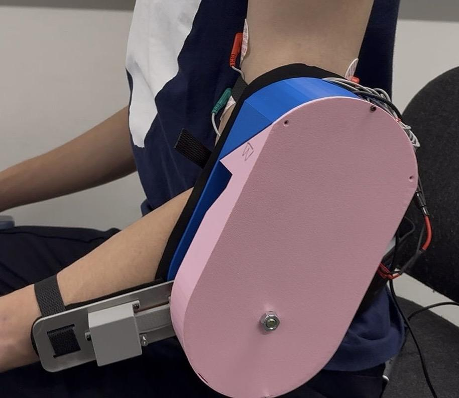
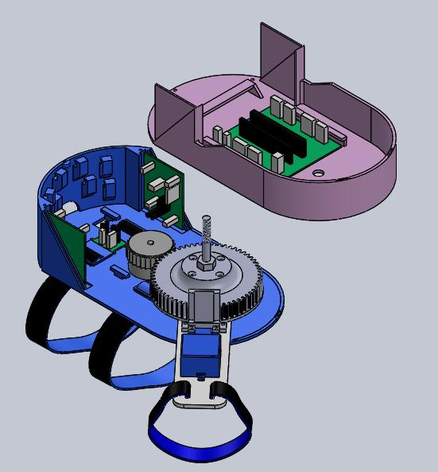
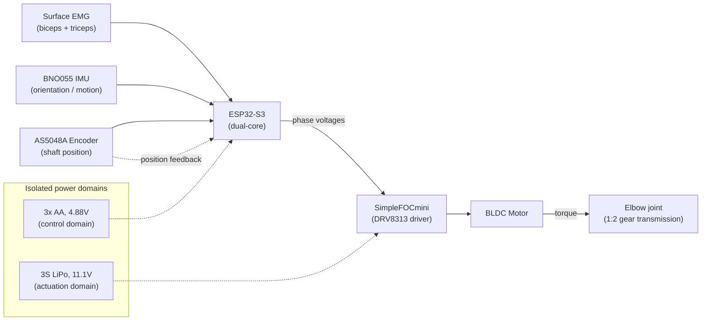

# ExoReach

A wearable, EMG-controlled upper-limb orthosis that provides powered elbow
flexion/extension assistance for paediatric physiotherapy (cerebral palsy
rehabilitation, ages 6–12). Built as a Year 2 group project in the MEng
Bioengineering programme at Imperial College London (DAPP2, June 2026).

<p align="center">
  
  &nbsp;&nbsp;
  
</p>

**My role: Electrical Team Lead / systems architecture designer.** I designed
the dual-core firmware architecture, the EMG signal-conditioning and torque
control pipeline, and the layered safety hierarchy; led the electrical
system integration; and debugged the demo-day firmware. The IMU driver was
written by a teammate and integrated by me — see [Credits](#credits) below
for the full breakdown.

This repo covers the **electrical and firmware side** of the project. Full
mechanical design, requirements, testing, and risk management are documented
in the group's final report (not included here — see Credits for how to ask
about it).

## Overview

Voluntary muscle activity (biceps/triceps EMG) is combined with IMU
orientation and encoder position/velocity feedback to estimate user intent
and joint state. A microcontroller uses this to compute an assistive torque,
delivered through a BLDC motor and a 1:2 gear transmission, while a layered
safety system watches for driver faults, collisions, and muscle spasms.

**Result (from testing):** 145° of elbow flexion, reliable EMG-based intent
detection across four test subjects, successful detection of simulated
spasms and collisions with automatic torque cutoff, 683 g total mass, and a
prototype build cost of £230 — see [Results](#results) for the full
breakdown.

## System architecture



No single sensor is sufficient on its own: EMG responds quickly but carries
no state information; the encoder measures position accurately but can't
distinguish voluntary from involuntary motion; the IMU detects abnormal
acceleration but has no notion of intent. Combining all three gives both
responsiveness and safety.

### Dual-core task partitioning

The ESP32-S3's two cores are explicitly split so that classifier inference
and EMG processing can never introduce timing jitter into the motor control
loop:

- **Core 0** — a single high-priority task: read the encoder, commutate the
  motor via field-oriented control (FOC), monitor the driver fault line.
- **Core 1** — under FreeRTOS: EMG acquisition/filtering/control-law
  computation, IMU orientation and spasm/collision monitoring, on-device
  neural-network intent classification, and the serial diagnostic interface.

The two cores exchange only lock-free shared state (target torque one way,
measured angle/velocity the other), so neither blocks on the other.

### EMG signal pipeline

Each channel is sampled at 2 kHz and passed through a 50 Hz notch (mains
interference) → 20 Hz high-pass (electrode-movement artefact) → rectification
+ 5 Hz low-pass (envelope) chain, then calibrated per-user against a
relaxed-baseline and maximum-voluntary-contraction (MVC) measurement so the
same normalised 0–1 activation signal drives the control law regardless of
electrode placement or individual muscle strength. A 200 ms sliding window
also extracts RMS, MAV, waveform length, zero-crossing count, slope-sign
changes, and variance, which feed a five-label intent classifier (Rest,
Reach, Lift, Hold, Spasm) trained in Edge Impulse and deployed on-device via
TensorFlow Lite Micro (98.4% validation accuracy, 14.3 KB flash, 1.4 KB RAM,
~1 ms inference latency).

### Control law

```
T = G·(b - t) - D·ω + K·sin(θ)
```

where `(b - t)` is normalised biceps-minus-triceps EMG effort, `ω` is joint
angular velocity, and `θ` is the arm's gravity angle from the IMU. Each of
the four active modes (Rest / Reach / Lift / Hold) uses a different `G`/`D`/`K`
combination — e.g. Rest sets all three to zero, Hold weights `K` most
heavily to support the limb against gravity.

### Safety hierarchy


Checks are ordered fastest-and-most-deterministic first (hardware fault,
then collision) so a delayed or incorrect classifier prediction can never
override a real-time safety condition. Spasm detection runs on two
independent paths — the classifier and a separate real-time IMU
acceleration monitor — that converge on the same damping-only response, so
a missed classification doesn't by itself remove spasm protection.

## Repository layout

```
firmware/
├── final/
│   └── main_demoday.cpp          — the system that ran on demo day
├── development/
│   ├── 01_bringup/                — each subsystem tested standalone
│   ├── 02_integration/            — subsystems combined one at a time
│   └── 03_data_collection/        — labelled dataset capture for the classifier
└── DEVELOPMENT_LOG.md             — narrative walkthrough of the above
```

See [`firmware/DEVELOPMENT_LOG.md`](firmware/DEVELOPMENT_LOG.md) for a
stage-by-stage account of how the firmware was built up — this is probably
more interesting than the final file alone, since it shows the bring-up and
integration process rather than just the end state.

## Hardware summary

| Sensor | Position | Data |
|---|---|---|
| Surface EMG (AD8232, re-tuned to 16–250 Hz passband) | Biceps + triceps | Voluntary muscle intent |
| AS5048A magnetic encoder (SPI) | Motor shaft | Absolute joint position + velocity |
| BNO055 IMU (I²C, NDOF fusion, 50 Hz) | Forearm | Orientation (gravity compensation), spasm/collision detection |

Actuation: BLDC motor (iPower GM3506, 11 pole pairs) via a SimpleFOCmini
(DRV8313) driver and a 30T/60T (1:2) spur gear pair, giving 0.25 Nm output
torque. Two isolated power domains (3×AA for control electronics, 3S LiPo
for actuation) prevent motor-switching noise from coupling into the
microvolt-scale EMG signal.

## Results

From bench and user testing (4 test subjects, full methodology in the
group's final report):

| Metric | Result |
|---|---|
| Elbow range of motion achieved | 145° (target: 0–150°) |
| EMG intent detection | Clean, repeatable spikes correlating with contraction |
| Simulated spasm detection | All simulated spasms detected; some false positives |
| Collision detection | 100% detection with motor cutoff |
| Continuous operation | 30 min with no mechanical/electrical failure |
| Thermal safety | No surface exceeded 41°C over 30 min |
| Total device mass | 683 g (target: <500 g — not met) |
| Prototype cost | £230 (target: <£450) |

Full requirements traceability, risk management (ISO 14971-style RPN
analysis), and mechanical/electrical appendices are in the group's final
report.

## Known limitations

- **Software ROM soft-brake is not yet tuned.** `ROM_MIN_RAD`/`ROM_MAX_RAD`
  in `firmware/final/main_demoday.cpp` are set to effectively unbounded
  placeholder values — we hadn't gotten to deriving real limits for this at
  the time of the demo. The mechanical hard-stops (Section 3.3.3 of the
  report) were the primary range-of-motion safety layer; the software
  soft-brake described in the control pipeline exists in the code but
  wasn't yet tuned against real joint angles.

## Credits

**Team:** Peter Connolly, Calvin Yap Tze Khai, Reyna Sew, Marianne Fayad,
Sara Mihalik, Qixuan Sun, Yunchu Hou, Dohun Kim — supervised by Dr Ian
Radcliffe, Department of Bioengineering, Imperial College London.

This repository documents the electrical/firmware work led by **Calvin Yap
Tze Khai** (electrical team lead, systems architecture design): dual-core
task partitioning, EMG signal-conditioning and control-law design, the
layered safety hierarchy, PCB/schematic design, and integration and
debugging of the full firmware stack, including the demo-day regression fix
and the AI training-data collection pipeline.

**Dohun Kim** wrote the BNO055 IMU driver and the spasm/collision detection
heuristics ([`06_imu_module_dohun_kim.cpp`](firmware/development/01_bringup/06_imu_module_dohun_kim.cpp)),
which were integrated into the wider dual-core architecture and safety
pipeline above.

Marianne Fayad contributed to the AI/classifier architecture; Qixuan Sun
led PCB layout; all team members contributed to requirements definition,
the Product Specification Document, and the final report.

## License

MIT — see [LICENSE](LICENSE). This is student coursework shared for
portfolio purposes; it has not undergone the regulatory testing or
certification required for clinical or home use.
